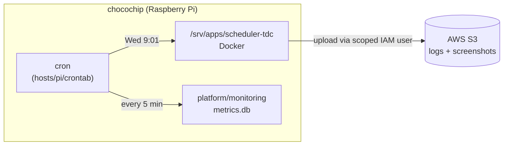

# Homelab

Infrastructure for a hybrid on-prem + AWS homelab: the machines, shared services and AWS setup
that apps run on. Apps and sites live in their own repos; this one decides where and when they run.

## What's running

| What | Where | Source |
|---|---|---|
| Health monitoring (CPU, RAM, disk, temp → SQLite every 5 min) | Pi, cron | [`platform/monitoring/`](platform/monitoring/) |
| Scheduler_TDC (weekly booking bot) | Pi, Docker, cron every Wednesday | [Scheduler_TDC repo](https://github.com/JeremyTran211/Scheduler_TDC) |
| S3 bucket + scoped IAM user for the bot's logs | AWS us-east-1 | [`cloud/aws/iam/`](cloud/aws/iam/) |

Hosts: **chocochip** (Raspberry Pi, live). An Intel NUC12 is planned.

## How it fits together



On the Pi, this repo is cloned to `/srv/homelab` and each app to `/srv/apps/<app>`.
The work runs at home; AWS handles what home can't do well: off-site storage today, and
later monitoring, alerts and a public entry point for hosted sites (see [ROADMAP.md](ROADMAP.md)).

## Layout

```
hosts/pi/crontab      the Pi's cron jobs (install with: crontab /srv/homelab/hosts/pi/crontab)
platform/monitoring/  health metrics scripts
cloud/aws/iam/        IAM policy templates
docs/pi-setup.md      setting up or rebuilding the Pi
ROADMAP.md            what's next
```

## Rules

- **No secrets in git.** `.env` files and AWS keys live only on the host. Policies use placeholders like `YOUR_BUCKET_NAME`.
- **Changes go through a branch and a PR** so the other person can review.
- **One login per person** for the Pi, AWS and GitHub. No shared accounts.
- **Nothing exposed directly to the internet** from the home network.

## Adding an app

An app repo needs a `Dockerfile`, a `.env.example`, and must run on ARM64. To host it:
clone it to `/srv/apps/<app>`, create its `.env`, and open a PR here adding its cron line
(or service) and any IAM policy it needs.
