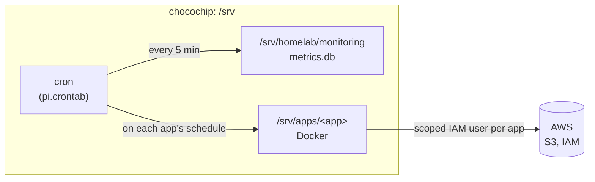

# Homelab

Infrastructure for a hybrid on-prem + AWS homelab: the machines, shared services and AWS setup
that apps run on. Apps and sites live in their own repos; this one decides where and when they run.

Host: **chocochip** (Raspberry Pi). An Intel NUC12 is planned.

## How it fits together



The work runs at home. AWS handles what home can't do well: off-site storage today, and later
monitoring, alerts and a public entry point for hosted sites (see [ROADMAP.md](ROADMAP.md)).

## Files

```
pi.crontab        the Pi's cron jobs: monitoring + each app's schedule
monitoring/       health metrics (CPU, RAM, disk, temp) into SQLite every 5 min
aws/              IAM policy templates
pi-setup.md       setting up or rebuilding the Pi
ROADMAP.md        what's next
```

## Rules

- **No secrets in git.** `.env` files and AWS keys live only on the host. Policies use placeholders like `YOUR_BUCKET_NAME`.
- **Changes go through a branch and a PR**, so the other person can review.
- **One login per person** for the Pi, AWS and GitHub. No shared accounts.
- **Nothing exposed directly to the internet** from the home network.

## Adding an app

An app repo needs a `Dockerfile`, a `.env.example`, and must run on ARM64. To host it:

1. Clone it to `/srv/apps/<app>` and create its `.env`.
2. Open a PR here that adds its line to `pi.crontab` (if it runs on a schedule) and any IAM policy to `aws/`.
3. After merging: `git pull` in `/srv/homelab`, then `crontab /srv/homelab/pi.crontab`.
