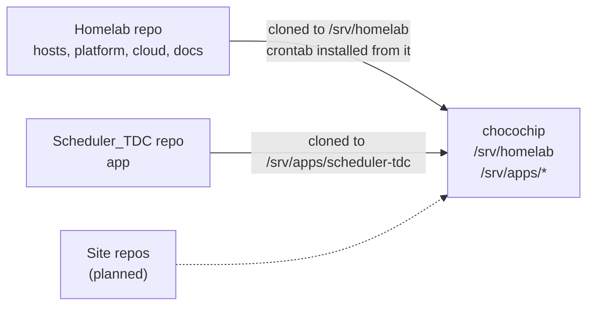
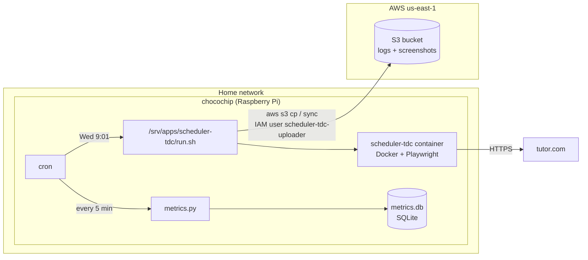
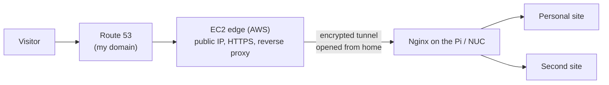

# Architecture

## Repos

The Homelab repo defines the platform. Each app repo is cloned under `/srv/apps/` and run
by the platform. See [hosting-an-app.md](hosting-an-app.md).

## Today

### Where data lives

| Data | Location | Kept |
|---|---|---|
| Scheduler logs and screenshots | `/srv/apps/scheduler-tdc/{logs,screenshots}`, copied to S3 | 30 days local, S3 indefinitely |
| Health metrics | `/srv/homelab/platform/monitoring/metrics.db` | Not backed up yet (roadmap) |
| Secrets | `.env` in each app folder, `~/.aws/credentials` | Never in git |

## Planned: hosting sites

- The sites are served from home hardware. AWS is the public front door.
- No ports are opened on the home router, and the home IP stays hidden.
- Optional later: an S3 + CloudFront copy of each site as a fallback when home is down.
